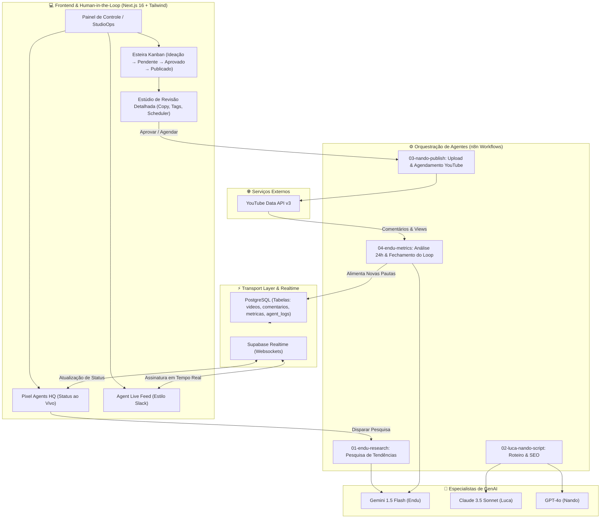

<div align="center">

# 🎬 StudioOps
### Plataforma Autônoma de Gestão de Conteúdo para YouTube com **Pixel Agents** & **Human-in-the-Loop**

[-black?style=for-the-badge&logo=next.js)](https://nextjs.org/)
[](https://www.typescriptlang.org/)
[](https://tailwindcss.com/)
[](https://supabase.com/)
[](https://n8n.io/)

<p align="center">
  <strong>Transformando IA generativa em um produto operacional de alta produtividade.</strong><br>
  Uma equipe de agentes autônomos especializados que pesquisa tendências, redige roteiros virais, otimiza SEO e agenda publicações — com o usuário no controle total como o "Chefe" aprovador.
</p>

</div>

---

## 💡 Por que o StudioOps foi criado? (Visão de Produto)

A maioria das aplicações de IA Generativa peca por dois extremos:
1. **Chatbots genéricos:** Caixas de texto vazias onde o usuário precisa inventar prompts complexos toda vez.
2. **Automações "caixa-preta":** Scripts que publicam diretamente sem supervisão, gerando alucinações, perda de controle de marca e quebra de confiança.

O **StudioOps** adota o conceito de **Agentic UI** (inspirado no projeto open-source *Pixel Agents*), dando rosto, especialidade e linguagem viva aos agentes de IA, aliados a uma esteira rigorosa de **Human-in-the-Loop (HITL)**. Nenhum vídeo vai ao ar sem a validação e o agendamento explícito do Chefe.

---

## 🕹️ A Equipe Pixel Agents

Em vez de logs técnicos opacos como `[Agent_1_Status: 200]`, o StudioOps personifica a inteligência em uma equipe especializada:

| Agente | Avatar | Modelo de IA | Responsabilidade & Especialidade |
|---|---|---|---|
| **Endu** | 📊 | **Gemini 1.5 Flash** (Google AI) | **Estrategista de Dados & Sentimento:** Utiliza a janela de contexto de 1M de tokens para ler centenas de comentários da audiência em lote, extraindo pautas virais reais e monitorando métricas de retenção. |
| **Luca** | ✍️ | **Claude 3.5 Sonnet** (Anthropic) | **Roteirista Criativo & Storytelling:** Especialista em copy de alta retenção, Few-Shot Prompting e ganchos nos primeiros 15 segundos para prender a atenção do público. |
| **Nando** | 🚀 | **GPT-4o** (OpenAI) | **Diretor de SEO & Publicação:** Rigidez sintática para gerar títulos virais (CTR), tags indexáveis, descrições com timestamps e integração direta com a YouTube Data API v3. |

---

## 🗺️ Arquitetura do Sistema



---

## 🔄 O Loop Fechado de Feedback (Feedback Loop)

Um dos maiores diferenciais de produto do StudioOps é o **fechamento do ciclo de dados**:
1. O **Nando** publica o vídeo no YouTube com metadados de SEO.
2. A cada 24 horas, o workflow do **Endu** coleta os novos comentários e estatísticas via YouTube API.
3. O **Gemini 1.5 Flash** processa o lote de comentários, categorizando o sentimento (Positivo/Neutro/Negativo) e identificando as dúvidas mais recorrentes da audiência.
4. O dashboard exibe as **Oportunidades Recomendadas pelo Endu** com contadores reais (ex: *"Pedido por 48 comentários"*).
5. O usuário clica em **[Gerar Roteiro]** e a esteira é realimentada com a pauta solicitada pelo próprio público!

---

## 📁 Estrutura do Repositório

```
StudioOps/
├── app/
│   ├── (dashboard)/
│   │   ├── page.tsx                  # Dashboard principal (Pixel Agents HQ + Analytics Recharts)
│   │   ├── roteiros/page.tsx         # Biblioteca e criação manual de pautas
│   │   ├── aprovacoes/
│   │   │   ├── page.tsx              # Esteira Kanban Human-in-the-Loop
│   │   │   └── [id]/page.tsx         # Estúdio de revisão em tela cheia (Copy, SEO, Scheduler)
│   │   └── configuracoes/page.tsx    # Gerenciamento de credenciais e status de conexões
│   ├── api/
│   │   ├── research/route.ts         # POST: Aciona agente Endu
│   │   ├── generate/route.ts         # POST: Aciona agentes Luca + Nando
│   │   ├── publish/route.ts          # POST: Aciona agente Nando para YouTube API
│   │   └── videos/
│   │       ├── route.ts              # GET / POST: Paginação e cadastro de vídeos
│   │       └── [id]/route.ts         # GET / PATCH / DELETE: Atualização parcial antes da aprovação
│   └── layout.tsx                    # Layout raiz com tema dark profissional
├── components/
│   ├── pixel-agents/                 # Camada de Agentic UI (Pixel Agents)
│   │   ├── AgentCard.tsx             # Card individual com avatar, glow e fala
│   │   ├── AgentHQ.tsx               # Painel da equipe com status ao vivo
│   │   ├── AgentFeed.tsx             # Feed estilo Slack com stream de mensagens
│   │   ├── AgentMessage.tsx          # Bolha de mensagem com ações de aprovação
│   │   ├── AgentStateIndicator.tsx   # Dot animado de status
│   │   └── AgentTypingIndicator.tsx  # Indicador de digitação
│   ├── approval/                     # Componentes Human-in-the-Loop
│   │   ├── KanbanBoard.tsx           # Quadro Kanban (Ideação → Pendente → Aprovado → Publicado)
│   │   ├── ScriptReviewModal.tsx     # Modal rápido de revisão
│   │   ├── DateTimeScheduler.tsx     # Agendador com horários de pico algorítmico
│   │   └── RejectFeedbackModal.tsx   # Devolução de pauta com orientações ao roteirista
│   ├── dashboard/                    # Analytics & Recharts
│   │   ├── MetricsCards.tsx          # 4 cards de KPIs (views, likes, sentimento, eficiência)
│   │   ├── PerformanceChart.tsx      # AreaChart da evolução de visualizações (30 dias)
│   │   ├── SentimentChart.tsx        # Donut Chart do sentimento da audiência
│   │   ├── VideoComparisonChart.tsx  # BarChart comparativo de vídeos
│   │   └── RecommendationsPanel.tsx  # Módulo de pautas virais do Endu (Feedback Loop)
│   └── ui/                           # Design System (Button, Card, Badge, StatusPill, Toast, Icons)
├── lib/
│   ├── supabase/                     # Clientes browser e server + tipos TypeScript
│   ├── pixel-agents/                 # State machine, definições dos agentes e Realtime
│   └── webhooks.ts                   # Despachante de webhooks para o n8n
├── n8n-workflows/                    # Workflows do n8n exportados e versionados em JSON
│   ├── 01-endu-research.json
│   ├── 02-luca-nando-script.json
│   ├── 03-nando-publish.json
│   └── 04-endu-metrics.json
├── sql/
│   └── 01-schema.sql                 # Script PostgreSQL pronto para rodar no Supabase
└── public/agents/                    # Avatares visuais (endu.svg, luca.svg, nando.svg)
```

---

## 🚀 Como Executar Localmente

### Pré-requisitos
- **Node.js** v20+ ou v22+
- **Git**

### Passo 1: Clonar o Repositório
```bash
git clone https://github.com/Anders0nlima/StudioOps.git
cd StudioOps
```

### Passo 2: Instalar Dependências
```bash
npm install
```

### Passo 3: Configurar Variáveis de Ambiente
Copie o arquivo de exemplo:
```bash
cp .env.example .env.local
```
*(Opcional: preencha as chaves do seu projeto no Supabase e URLs do n8n. O sistema conta com dados de demonstração resilientes caso as chaves não estejam preenchidas imediatamente).*

### Passo 4: Executar em Modo de Desenvolvimento
```bash
npm run dev
```
Abra [http://localhost:3000](http://localhost:3000) no seu navegador.

---

## 🌿 Histórico de Desenvolvimento e Branches

O projeto foi construído seguindo rigorosamente a metodologia de commits semânticos (*Conventional Commits*) e branches dedicadas para cada fase:

| Branch | Fase | Entregas Principais |
|---|---|---|
| `feat/fase-1-setup-e-ui` | **Fundação** | Scaffolding Next.js, Schema PostgreSQL do Supabase, Design System dark. |
| `feat/fase-2-pixel-agents` | **Pixel Agents UI** | State machine (`idle/thinking/working/waiting_approval/done`), Live Feed estilo Slack, Kanban Board. |
| `feat/fase-3-n8n-agentes` | **Backend & Webhooks** | API Routes (`/api/research`, `/api/generate`, `/api/publish`, `/api/videos`), 4 workflows JSON do n8n. |
| `feat/fase-4-aprovacao-publicacao` | **Human-in-the-Loop** | Estúdio de revisão em tela cheia (`/aprovacoes/[id]`), agendador algorítmico, modal de feedback. |
| `feat/fase-5-analytics` | **Analytics & Loop** | Gráficos Recharts (Performance, Sentimento, Comparativo), módulo de recomendações do Endu, documentação. |

---

## 🎯 Destaques para Avaliação de Competências (GenAI)

- **Engenharia de Prompts Avançada:** Utilização de Few-Shot Prompting e Chain-of-Thought no agente roteirista para garantir ganchos de alta retenção.
- **Especialização de Modelos (Model Routing):** Uso consciente de modelos com características complementares (custo vs velocidade vs profundidade analítica).
- **Governança e Human-in-the-Loop:** Garantia de que ações de alto impacto (publicação e alteração de metadados) exijam validação humana explícita.
- **Arquitetura Reativa com Realtime:** Supabase Realtime atuando como barramento de eventos para alimentar a interface sem necessidade de polling.
- **Visão de Negócio:** Foco em métricas reais de produto (CTR, retenção, taxa de engajamento e satisfação do usuário).

---

<div align="center">
  Desenvolvido por <strong>Anderson Lima</strong> • 2026
</div>
